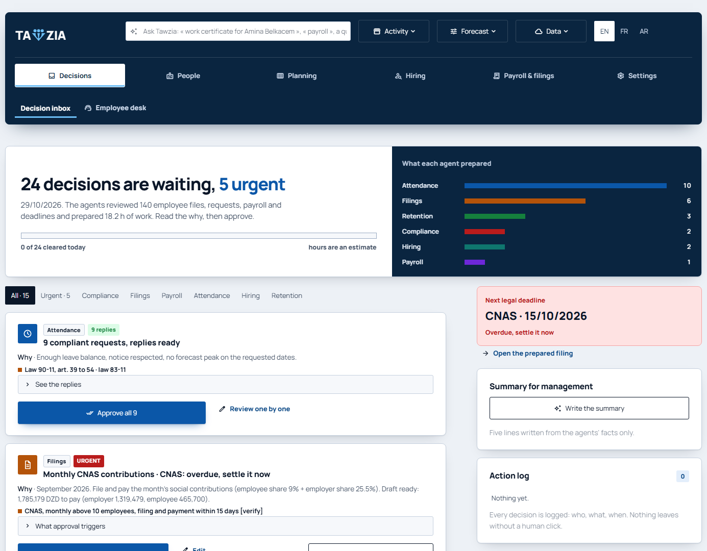
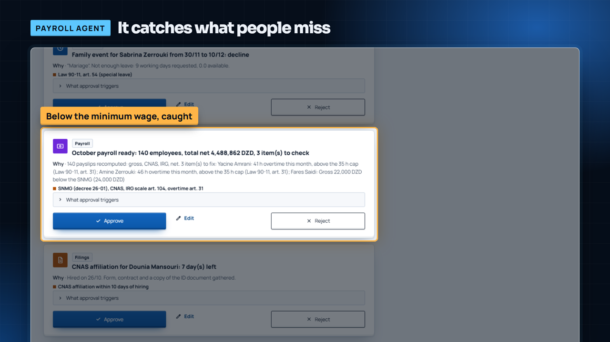
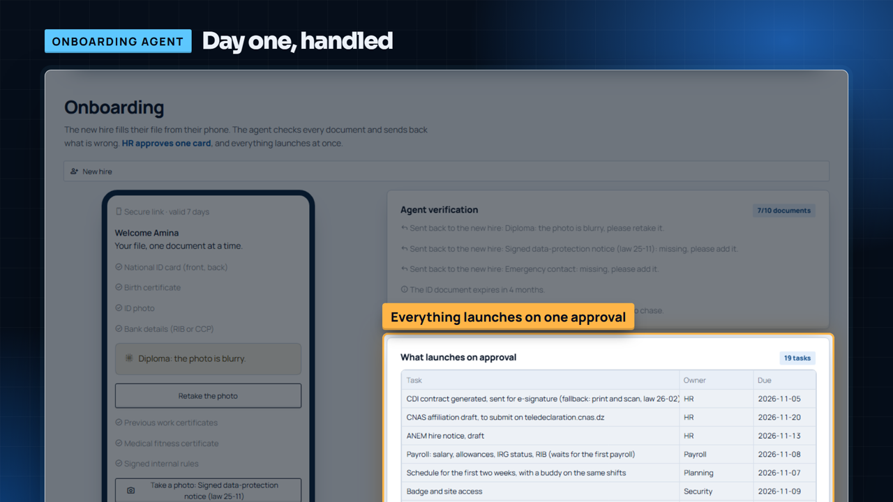

# Tawzia

**An AI HR department for Algerian companies. The agents do the HR work; HR only approves.**

**[Live demo](https://tawzia.streamlit.app)** · **[Demo video](VIDEO_LINK)** · [How it works](docs/ARCHITECTURE.md) · [What's next](ROADMAP.md)

Tawzia prepares payroll, filings, leave decisions, schedules, hiring and onboarding
against Algerian labour law, then puts every finished task in one inbox: what the
agent did, why, which rule it applied, and three buttons. Nothing is sent, filed,
paid or rejected without a human click.



The live demo runs on a fictional 140-person company, so every screen works without
importing anything. Open it, read a card, click **Approve**.

| The payroll agent catches a salary below the minimum wage | The onboarding agent sends back a blurry document |
|---|---|
|  |  |

> The business case is in [`PITCH.md`](PITCH.md), the provenance of every figure in
> [`SOURCES.md`](SOURCES.md), a demo walkthrough in [`DEMO_GUIDE.md`](DEMO_GUIDE.md), and
> the architecture in [`docs/ARCHITECTURE.md`](docs/ARCHITECTURE.md).

---

## Why it exists

Algerian HR is paperwork-heavy and rule-bound: monthly G50 income-tax filing, CNAS
contributions, the annual DAS, CNAS affiliation within 10 days of each hire, the ANEM
5-working-day vacancy window, and data-protection law 25-11. Global HR suites do not
know these rules, and local tools digitise the forms without doing the work.

Tawzia also models the real Algerian calendar: a **Friday-Saturday weekend**, the
**Hijri calendar** (Ramadan and the two Eids move about 11 days earlier each year), and
a summer that is a **diaspora peak**, not a lull.

## What is in the app

Nine agents across five areas plus Settings. English by default, French and Arabic
(right to left) one click away. A six-step guided tour runs on first visit.

| Screen | What it does |
|---|---|
| **Decisions** | The approval inbox. Agents for attendance, payroll, filings, compliance, retention, hiring, onboarding and the employee desk drop cards here, most urgent first. Compliant replies are batched into one click. A progress bar shows the day being cleared. |
| **Decisions › Employee desk** | Employees ask in French, Arabic or Darija ("nheb attestation de travail lel bank") and get a bilingual work certificate, their leave balance or payslip, with HR signing in the inbox. |
| **People** | Employee files, leave and attendance, skills and internal mobility, rule-based retention early warning. |
| **Planning** | A weekly schedule from an OR-Tools CP-SAT solver with the law as hard constraints (40 h week, 20% overtime cap, weekly rest, night-work rules for under-19s and women without a site waiver), kept stable week to week. Ramadan hours on a switch. Demand comes from a walk-forward backtested forecast. |
| **Hiring** | Job posts written from one sentence, Algerian sourcing channels, ranked candidates with a four-fifths bias audit, the ANEM window countdown, and phone-based onboarding that HR approves with one card. |
| **Payroll & filings** | 2026 payroll (SNMG, CNAS by branch, IRG with smoothing) from a dated rules file, bilingual payslips, G50 / CNAS / DAS drafts with deadlines and portal links, anomaly detection, inspection simulator, Official Journal watch. |
| **Settings** | Ask Tawzia (chat over company figures), **PDF to AI text**, company data import, privacy and trust controls (PII masking, local model, action log, incident register), evidence and sources. |

**"Ask Tawzia"** in the top bar acts, not only answers: "work certificate for Amina
Belkacem" creates the card, "Ramadan starts Thursday, redo the schedule" regenerates the
week, a screen name opens it.

> **The demo company is fictional.** Its 140 employees, two sites and operational volumes
> are simulated. The calendar, weather, labour law and pay rules they run on are real,
> and every screen says so.

## PDF to AI text

Any PDF (contract, policy, payslip, CV) becomes clean Markdown with page markers,
headings and lists, plus paragraph-aligned chunks sized for an AI context window
(JSONL for embedding pipelines). Hyphenated line breaks are rejoined and repeated
headers, footers and page numbers removed; personal data can be masked. Scanned pages
without a text layer are listed, not guessed. Available in Settings and as the MCP
tool `tawzia_pdf_to_text`. Nothing leaves the machine.

## MCP server

The same engine is exposed to AI assistants through the Model Context Protocol:

- `tawzia_mcp/server.py`: 10 public, read-only tools (net salary, employer cost,
  overtime and shift legality, CDD validity, compliance calendar, public holidays,
  labour-law search, payslip lines, PDF to text).
- `tawzia_mcp/company.py`: 18 company tools behind bearer tokens, scoped by role. Read
  tools, plus draft tools that only create inbox cards. No tool can approve, file,
  send, pay, delete or reject.

See [`tawzia_mcp/README.md`](tawzia_mcp/README.md); evaluations in
`evaluations/tawzia_mcp_eval.xml`.

## Trust and data protection

- Field-level AES-256-GCM encryption of ID numbers, bank details, CNAS numbers and
  health fields; role-based access (employee, manager, HR, payroll, auditor).
- Every sensitive read and every decision written to an action log (law 25-11).
- Personal data replaced by tokens before any call to an external language model, and
  restored in the answer; a local open-weights model option for sovereign hosting.
- Human approval on every hire, rejection, payment and filing.

---

## Built by

**Anya Louni**, solo: research, product, design, engineering and the pitch.

## Install

Python 3.10 or newer (developed on 3.13).

```bash
python -m venv venv
venv/Scripts/activate        # macOS / Linux: source venv/bin/activate
python -m pip install -r requirements.txt
streamlit run dashboard.py
```

The app opens on `http://localhost:8501`. The first load of a forecast runs a
walk-forward backtest (about three minutes); results are cached on disk afterwards.

**Optional AI key.** The language layer uses [Groq](https://console.groq.com) (free
tier). Create a `.env` file at the root:

```
GROQ_API_KEY=your_key
GROQ_MODEL=openai/gpt-oss-120b
```

Every owned model (forecast, solver, payroll, anomaly detection, CV ranking, PDF
conversion) runs without a key. For a local model, set `TAWZIA_LOCAL_MODEL` to an
Ollama model name.

## Tests

```bash
python tests/test_payroll.py        # IRG / CNAS test vectors
python tests/test_mcp.py            # public MCP tools
python tests/test_mcp_company.py    # company MCP tools, roles, drafts
python tools/check_pages.py         # every screen renders without error
python -m core.scheduler            # each core module self-tests the same way
```

## Project layout

```
dashboard.py            entry point and navigation
app_pages/              one file per screen
core/                   the engine; every module self-tests with python -m core.<name>
  autopilot.py          agents -> inbox cards
  payroll_dz.py rules.py legal.py filings.py   pay, rules, legal checks, filing drafts
  scheduler.py          CP-SAT weekly schedule
  self_service.py       employee desk (FR / AR / Darija)
  onboarding.py db.py   onboarding agent, encrypted employee database
  pdf_ingest.py pii.py bias.py   PDF to text, PII masking, bias audit
  forecast.py demand.py calendar_dz.py weather_dz.py   demand forecast on the real calendar
config/dz_payroll_2026.toml   every legal rate, dated; values marked [verify] are configurable
tawzia_mcp/             MCP servers
tests/                  test suites
```

## Honesty rules

Every number is traceable to a source in `core/sources.py` or labelled as an assumption.
Values marked **[verify]** in the rules file come from a single private source or
conflicting sources and must be confirmed before a live payroll run.

## What's next

Five pilot companies running a real payroll month alongside their current method, a
payroll accountant validating the rules engine, then individual logins, hosting in
Algeria and the employee desk on WhatsApp. Details in [`ROADMAP.md`](ROADMAP.md).
