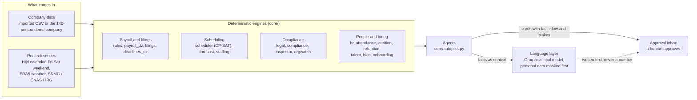

# How Tawzia works

This document describes the platform's mechanics: where the numbers come from,
who calculates them, where the language layer stops, and where a human must
click. Read it before opening the code.

## The rules that shape everything

> **Engines calculate, the language model writes, a human approves.**

1. Every figure on screen comes from a `core/` module. The model receives facts
   that are already calculated and returns text. It has no path back into the
   calculations.
2. Agents prepare work as **cards** in the Approval inbox. No agent sends,
   files, pays, hires or rejects without an HR click on *Approve*.
3. Legal rates (SNMG, CNAS, IRG scale, overtime cap) live in one dated file,
   `config/dz_payroll_2026.toml`, never hard-coded.



The dotted line is the model's only way back, and it only reaches the display.

## The layers

### 1. Inputs

| Source | What it provides | Real or simulated |
|---|---|---|
| `core/seed_company.py` | A fictional company: 140 employees on two sites (Algiers, Ouargla) with planted compliance gaps | **Simulated**, labelled on every screen |
| `core/company_data.py` | Staff register and attendance imported as CSV | Real once a file is uploaded |
| `core/calendar_dz.py` | Hijri calendar, Ramadan, both Eids, public holidays, Fri-Sat weekend | Real, checked against Aladhan |
| `core/weather_dz.py` | Observed weather per wilaya (Open-Meteo ERA5) | Real |
| `config/dz_payroll_2026.toml` via `core/rules.py` | SNMG, CNAS branches, IRG scale, overtime and night rules | Real, sourced, values marked [verify] where sources disagree |
| `core/sources.py` | The register of every figure and its provenance | The reference |

### 2. Agents

`core/autopilot.py` runs seven agents over the company data and returns cards
with a title, the decision to take, the law that applies, the minutes saved and
the money at stake:

- **Attendance**: leave and short-absence requests, checked against load and law.
- **Payroll**: the month's run with CNAS and IRG, salaries below the SNMG flagged.
- **Filings**: G50, CNAS and DAS drafts with their deadlines and portals.
- **Compliance**: overtime-cap breaches, under-19 night work, probation ends.
- **Retention**: at-risk employees with the cheapest lever to keep them.
- **Recruiting**: job posts, ANEM filing, ranked applicants with a bias audit.
- **Employee desk**: attestations and payslip questions in English, French,
  Darija and Arabic.

### 3. Engines

Every `core/` module has a self-checking `__main__`:

```bash
venv/Scripts/python.exe -m core.payroll_dz
venv/Scripts/python.exe -m core.scheduler
venv/Scripts/python.exe -m core.autopilot
```

Main chains:

- **Payroll to filings**: `payroll_dz` builds payslips (CNAS, IRG with smoothing
  and the special regimes); `filings` drafts G50, CNAS, DAS and the bank file;
  `deadlines_dz` derives due dates, moved to the next working day.
- **Scheduling**: `scheduler` solves a weekly roster with OR-Tools CP-SAT under
  hard legal constraints (Law 90-11 art. 27, 28, 29, 31, 33).
- **People**: `hr` holds leave entitlement, `attendance` clock data,
  `attrition` leaving risk, `retention` the costed counter-offer.
- **Hiring**: `job_post` writes the post from team facts, `talent` ranks the
  pool, `bias` runs the four-fifths audit, `onboarding` tracks documents.

### 4. Data protection (Law 25-11)

- `core/db.py`: SQLite with AES-256-GCM field encryption for NIN, RIB and
  salary; role-based access; every access and change goes to `action_log`.
- `core/pii.py`: names, phone numbers, NIN, RIB and emails are replaced by
  tokens before any AI call, then restored in the answer.
- A local model option (`TAWZIA_LOCAL_MODEL`, Ollama) keeps everything on the
  machine.

### 5. Language layer

`core/ai.py` talks to Groq (`openai/gpt-oss-120b`) or a local model.
`core/copilot.py` routes each question to one domain (scheduling, people and
payroll, decisions) so the model gets a short, relevant context. Guards live in
code, not prompts: job-post conditions are recalculated over the model's text,
and bullets about pay or leave from the model are filtered out. Without a key,
everything works except free conversation.

### 6. MCP servers

- `tawzia_mcp/server.py`: 10 public tools (net salary, employer cost, overtime
  and shift legality, deadlines, holidays, law search, payslip lines, PDF to
  text). Read-only.
- `tawzia_mcp/company.py`: 18 company tools behind Bearer tokens and role
  scopes. Tools read, calculate or create a card. None approves, files, sends,
  pays, deletes or rejects.

### 7. Interface

`dashboard.py` declares five working areas plus Settings, with a hand-built
navigation (`core/nav.py`). The chat uses an in-house component
(`components/tawzia-chat`): the thread stays server-side, so **no API key ever
reaches the browser**. English is the default; French and Arabic (RTL) are one
click away.

## Checking that it all holds

```bash
venv/Scripts/python.exe tests/test_payroll.py
venv/Scripts/python.exe tests/test_mcp.py
venv/Scripts/python.exe tests/test_mcp_company.py
venv/Scripts/python.exe tools/check_pages.py
```

The first page check warms the caches, which is also the right preparation
before a demo.

## What the platform does not do

- It files nothing with CNAS or the tax office: it prepares the draft, reminds
  the date and opens the right portal.
- It replaces neither an accountant nor a lawyer, and the screens say so.
- It does not call real ANEM, CNAS or DGI systems in this version.
